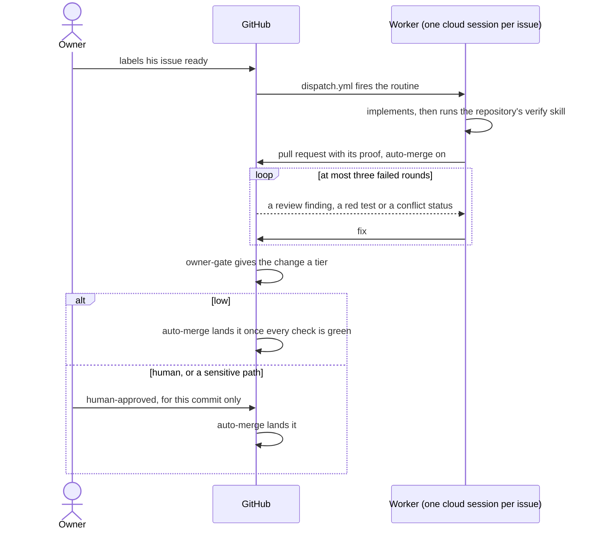

# Factory

A native software factory for a GitHub repository: cloud Claude sessions take the owner's issues and ship pull requests that land with no human in the loop. It calls the owner in three cases only: a change a revert cannot undo, a sensitive path, or three fix rounds without success.

## The loop



1. The owner labels his own issue `ready`; `dispatch.yml` fires a claude.ai routine through its API trigger.
2. The routine's cloud session, the Worker, replaces `ready` with `in-progress`, implements the issue per `CLAUDE.md`, runs the repository's `verify` skill, and opens a pull request with auto-merge on. A hook keeps it from ending its turn on a working tree it has not verified.
3. `review.yml` reviews each push and fails while it has a finding. At the third commit on which `review` or `test` failed, it labels the pull request and its issue `needs-human`, and the Worker stops until the owner comments what to do and removes the label.
4. `owner-gate.yml` gives the head commit a tier. A floor decides first: a path of `CODEOWNERS`, a path or a line cap of `tier.json`. Past it, Claude Haiku reads the diff alone and answers whether a revert undoes the change and a check catches a mistake in it. `tier:low` lands once `test`, `review` and `owner-gate` are green; `tier:human` waits for the owner's `human-approved` label, which any push removes.
5. Auto-merge squashes the pull request, through the merge queue where the repository has one.

Two cases have no event of their own on a pull request, and each has a workflow:

| Case | Workflow | What it does |
|------|----------|--------------|
| A pull request conflicts with the default branch | `conflict.yml`, on each push to it | Sets a failed `conflict` status on the head commit, which auto-fix delivers to the session. A third conflict labels the pull request `needs-human` |
| The default branch's CI turns red | `trunk-red.yml`, when the CI workflow completes | Opens a `trunk-red` issue and fires the routine on it. After two repairs that leave it red, the issue is `needs-human` and no Worker starts |

A session stopped by something outside its issue comments on the issue and labels it `blocked`; the owner labels it `ready` again once the way is clear.

GitHub offers the merge queue in a public repository of an organization, and in a private one under GitHub Enterprise Cloud. Both workflows above are installed with or without it.

The factory's pull requests target the repository's default branch. A repository whose working trunk is not its default branch is not supported.

## Labels

| Label | On | Set by | Meaning |
|-------|----|--------|---------|
| `ready` | issue | the owner, without an app; `trunk-red.yml` on its own issue | Start a Worker on it |
| `in-progress` | issue | the Worker | Claimed |
| `blocked` | issue | the Worker | Something outside the issue stops it |
| `needs-human` | issue and pull request | the round cap, the conflict bound, the trunk bound | A bound was reached: the factory stopped |
| `trunk-red` | issue | `trunk-red.yml` | The repair issue of a red default branch |
| `tier:low`, `tier:human` | pull request | the owner gate | Shows the tier of the head commit; no check reads it |
| `human-approved` | pull request | the owner, without an app | Approval of the head commit; removed by any push |

## Skill

| Skill | Invocation | What it does |
|-------|------------|--------------|
| `install` | `/factory:install [owner/name]` | Creates the routine and versions it in `~/dotfiles/cloud/routines/`, writes the factory's files into the current repository, records its `verify` recipe, writes its tier rules and validates its tier cases with the owner, and reports what the GitHub side still lacks. Asks the owner before every change outside the working tree. |

## Templates

`templates/` holds the files proven in the trial repositories, but for the trial's own path in `deep-review-paths` and five parameters:

| Parameter | Flag | Value |
|-----------|------|-------|
| `{{OWNER}}` | `--owner` | the owner's GitHub login |
| `{{REPO}}` | `--repo` | `owner/name` |
| `{{ROUTINE_ID}}` | `--routine` | the routine's `trig_…` id |
| `{{BRANCH}}` | `--branch` | the repository's default branch, a git branch name |
| `{{CI}}` | `--ci` | the name of the repository's CI workflow, which `trunk-red.yml` listens to |

```
templates/
├── repo/                          lands at the same paths in the target repository
│   ├── .github/
│   │   ├── CODEOWNERS             every file that defines a check: .github/, .claude/, CLAUDE.md
│   │   ├── deep-review-paths
│   │   ├── factory/
│   │   │   ├── tier.ts            the floor, the call to the classifier, the replay of the cases
│   │   │   ├── tier.json          the line cap and the paths that always wait for the owner
│   │   │   ├── tier-prompt.md     the classifier's question
│   │   │   └── tier-cases.json    the cases, and the model and prompt they validated
│   │   └── workflows/             dispatch, review, owner-gate, conflict, trunk-red
│   └── .claude/
│       ├── commands/pr-review.md
│       └── hooks/require-verify.sh
├── settings-hooks.json            the two hook entries merged into .claude/settings.json
├── routine/prompt.md              the routine's prompt
└── claude-md-sections.md          the CLAUDE.md sections the session and the review follow
```

`.claude/skills/verify/SKILL.md`, the repository's own verify recipe, has no template: the install records it. `tier.json`, `tier-prompt.md` and `tier-cases.json` are rewritten for each repository by the install; until a replay validated the cases, the floor runs alone and every change that passes it waits for the owner.

A template changes only after the same change has run in a trial repository. A package rule in `renovate.json` turns Renovate off under `templates/`, so an action or dependency update reaches the templates through the trial alone.

## Scripts

| Script | What it does |
|--------|--------------|
| `scripts/install.ts repo --owner --routine --branch --ci [--target] [--force]` | Renders `templates/repo/` into a working tree and merges the two verify hooks into its `.claude/settings.json`, keeping what the file holds. Refuses to overwrite a file that differs unless `--force`; prints `wrote`, `identical`, `overwrote` or `refused` per file, `merged`, `identical` or `refused` for the settings. No GitHub call, no commit. |
| `scripts/install.ts prompt --owner --repo --branch --dir [--force]` | Renders the routine's `prompt.md` into a directory. |
| `scripts/check.ts --repo <owner/name>` | Reads, through `gh`, the labels, the files on the default branch and what the gate, the review, `CODEOWNERS`, the verify skill and `CLAUDE.md` say, the hooks of its `.claude/settings.json`, the CI workflow `trunk-red.yml` names (a job that reports the check `test` on pull requests and on pushes to the default branch, with no paths filter), the ruleset (required checks, resolved threads, merge queue, no bypass actor), the auto-merge and squash merge settings, whether GitHub Actions runs the workflows' actions, and the secret names; one line per item, `ok` or `missing` with its fix, an item the token cannot read marked `not visible`. Exit 1 while one is missing. On a private repository it prints what a workflow's token may do by default. Never reads a secret's value. |

In the target repository:

| Script | What it does |
|--------|--------------|
| `.github/factory/tier.ts gate --repo --pr --head [--ask]` | The tier of a pull request's head commit, run by `owner-gate.yml` from the base branch. Reads the change through GitHub's API, never from a checkout. Any failure answers `human`. |
| `.github/factory/tier.ts replay --repo [--record]` | Judges each case of `tier-cases.json` three times and reports agreement and every false `low`. `--record` writes the model and the prompt a clean run validated. |

Each subject of `install.ts` takes exactly the parameter flags its templates name and refuses any other, and an empty path.

## Requirements

- `bun`
- `gh`, signed in as the owner
- The Claude GitHub App on the repository, a claude.ai routine with an API trigger, and the secrets `CLAUDE_CODE_OAUTH_TOKEN` and `ROUTINE_FIRE_TOKEN`
- A CI workflow with a job named `test` that runs on `pull_request`, on `push` to the default branch, and on `merge_group` where the repository has a merge queue
- The owner's routine convention, which the install skill follows: each routine is versioned in `~/dotfiles/cloud/routines/<name>/` (`routine.json`, `prompt.md`), and `bun run routines:check` in `~/dotfiles` exits 0

## License

MIT

## Author

Augustin BENGOLEA (bengous@protonmail.com)
